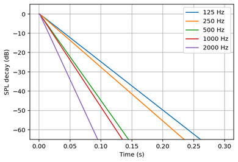
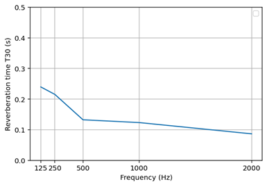

# Summary

Studying the acoustics of enclosed spaces is important for improving the quality of environments and reducing noise-induced health effects. With the rise of numerical room acoustics modelling, tools are needed to predict sound behaviour in enclosed spaces. `acousticDE` is open-source software for simulating room acoustics using the diffusion equation approach. The software is designed to be easy to use and suitable for research applications, consultancy work, and educational purposes. In practice, it can be used for evaluating design choices during early architectural design stages, optimising acoustic treatment layouts, or testing the performance of rooms intended for speech, music, or general occupancy.

The method implemented in `acousticDE`---the diffusion equation method (DE)--- offers a balance between computational efficiency and flexibility with regard to the types of spaces. To simulate a room sound field, `acousticDE` requires a digital 3D model of the geometry and the material properties describing the acoustic boundaries. Once configured, `acousticDE` can incorporate sound sources, compute the sound energy throughout the space, and provide key room acoustics parameters relevant to practical acoustic assessments.

# Statement of need

Room acoustics simulation is essential for researchers and practitioners to accurately predict and design the acoustics inside a room. However, existing tools often face a trade-off between (1) accuracy and efficiency in the calculation method and (2) transparency in the software's functionality and operation. Traditional statistical methods, such as the Sabine and Eyring calculations, provide a fast global estimate of the acoustic parameters, but these are based on unrealistic assumptions that are only valid for certain rooms and within certain frequency ranges [@Kuttruff2019RoomAcoustics]. More accurate approaches are available, including both commercial and open-source software. However, commercial tools often lack transparency, as it is difficult to understand how the calculations are performed internally. Available tools are mostly based on common approaches for running high-frequency simulations, i.e., geometrical acoustics methods. Additionally, full wave-based approaches can achieve higher accuracy but require significant computational resources, making them impractical for larger spaces.

`acousticDE` was developed to address both these gaps. It is designed for the simulation of room acoustics using the DE method, targeting researchers, practitioners, and educators seeking a transparent and efficient method for high-frequency room acoustics.

# State of the field

The DE model has emerged as an effective compromise for room acoustics simulations in the high-frequency range, providing physically meaningful spatial and temporal distributions of acoustic energy while remaining computationally efficient [@Foy2016IncludingApproach; @Mou2023AnSpaces; @SuGul2020ComparativeStations]. However, despite its demonstrated usefulness in the literature, accessible and user-friendly open-source software implementations of the acoustic diffusion equation model do not exist [@Hornikx2024] or are somewhat limited. In fact, most implementations of the diffusion equation are embedded in commercial tools (e.g., COMSOL or the Femlab toolbox for MATLAB), where room acoustics simulations are not the primary focus. An additional open-source implementation exists, but it is currently at its initial experimental stage, lacks documentation, and is written in the GNU Octave programming language [@univgustaveeiffel].

Compared to the available software, `acousticDE` distinguishes itself by providing two different numerical methods for implementing the DE model within a Python programming environment: the Du Fort--Frankel finite difference method (FDM) [@Navarro2012ImplementationRooms] and the finite volume method (FVM) [@PaganMunoz2019NumericalMethods]. The FDM is suitable for parallelepiped shapes, while the FVM supports arbitrary 3D geometry through a volumetric tetrahedral mesh. The dual approach allows the user to select the appropriate balance between flexibility and efficiency, depending on the room type and the dimension of the discretization. Compared to other tools for the high-frequency range, such as pyroomacoustics [@Scheibler2018] and sound particle tracing [@ISimpa2012], the DE model is easy to use and requires little computation time. However, for non-proportional geometries or highly absorptive spaces, the diffusion equation does not reach the level of accuracy of more detailed (but computationally more costly) acoustics methods (geometrical acoustics or wave-based methods). It is instead accurate for compact spaces with highly reflective surfaces.

In addition to standard room-acoustics parameters, `acousticDE` can generate impulse responses and support auralization, enabling perceptual audio demonstrations of simulated acoustic conditions. Comprehensive and well-structured documentation accompanies the software.

# Method

The DE method, originally introduced by Ollendorff [@Ollendorff1969AbsorptionWaves] and later refined [@Picaut1997AEquation], overcomes some of the limitations of statistical room acoustics, which is grounded in the diffuse-field assumption [@Sabine1922CollectedAcoustics]. Compared to wave-based approaches [@Hamilton2017FDTDTime; @Wang2019RoomMethod], ray- and beam-tracing algorithms [@Kuttruff2019RoomAcoustics], or the image source method [@Kuttruff2019RoomAcoustics], the DE method is generally more accurate than Sabine- or Eyring-based estimates while remaining computationally inexpensive.

The DE method estimates how acoustic energy is distributed over time and space within a specific room. It is based on solving the diffusion equation, which is applicable in the high-frequency range (above the Schroeder frequency) and assumes only diffusely reflecting boundaries following Lambert's law [@Valeau2006OnPrediction]. The DE method is based on the energetical approach, where sound has undergone multiple reflections and scattering in an environment. It represents the late stage of wave propagation, where the energy, after being reflected multiple times, is spread out across the space, following the diffusion process of gas and heat in a medium. Surface absorption, atmospheric absorption, and diffusion are included. Limitations include the omission of diffraction, early reflections, and partially scattering surfaces, as well as reduced accuracy at high average absorption coefficients.

The governing diffusion equation and boundary condition are:

$$
\frac{\partial{w(\mathbf{r}, t)}} {\partial{t}} = D \boldsymbol{\nabla}^2 w(\mathbf{r}, t) - m c w(\mathbf{r}, t) + q(\mathbf{r}, t)
$$

$$
-D \dfrac{\partial w}{\partial n} = h w
$$

where $w(\mathbf{r}, t)$ is the energy density at each position $\mathbf{r}$ and at time $t$, $m$ is the atmospheric attenuation coefficient, $c$ is the speed of sound, $q(\mathbf{r}, t)$ is the source term, and $h$ is the boundary absorption term. Several methodologies propose expressions for $h$ based on different assumptions about how to treat the surface absorption coefficients of the room: the Sabine [@Picaut2002NumericalProcess], the Eyring [@Jing2007APredication], and the modified absorption term [@Jing2008OnExperiments]. The diffusion coefficient $D$, with units of m$^2$/s, indicates how quickly sound diffuses around the room. This depends on the mean free path of the room.

From the energy density, the reverberant-field sound pressure level (SPL) can be calculated as follows:

$$
\text{SPL}(\mathbf{r},t) = 10  \log_{10} \left(\frac{\rho c^2 w(\mathbf{r},t)} {p_{\text{ref}}^2}\right)
$$

where $\rho$ is the density of air in kg/m$^3$ and $p_{\text{ref}}$ is equal to $2 \times 10^ {- 5}$ Pa [@Navarro2015].

This method allows the calculation of room acoustics parameters (e.g., sound pressure level and reverberation time). Example results are shown in the figure below and included in the example gallery in the documentation.

Figure 1. SPL decay (left) and reverberation time $T_{30}$ (right) for a room measuring $3\,\mathrm{m} \times 3\,\mathrm{m} \times 3\,\mathrm{m}$, with the source at (1.5 m, 1.5 m, 1.5 m) and the receiver at (2.0 m, 1.5 m, 1.5 m). The absorption coefficients at the respective frequencies are [0.3, 0.33, 0.5, 0.53, 0.7]. This example uses the modified absorption term [@Jing2008OnExperiments].

# Software design

## Design trade-offs

The design of `acousticDE` is shaped by the needs of room acoustics simulation research, which are transparency, reproducibility, and modularity. The software is implemented in Python since it is open-source and widely accessible compared to licensed alternatives, such as MATLAB. In addition, it is an easier and more understandable language for researchers and users from different fields than lower-level languages such as C++ and Fortran.

**Method-centric modularity:** Rather than implementing a single abstract solver interface, `acousticDE` is organised around self-contained modules: FDM, FVM, and Auralization.

Each module exposes a clear functional API, such as `run_fvm_sim(...)`, and maintains its own workflow. This structure mirrors typical room-acoustics workflows and prioritises clarity over complex abstraction layers. While the software is developed as a standalone project, its architecture allows for potential future integration or coupling with other tools (such as the image source method for the early part of the decay), provided that common inputs are used.

**Workflow design:** `acousticDE` adopts a functional, sequential pipeline rather than an object-oriented architecture. The FVM and Auralization pipelines are shown below as examples, as they represent the most structurally demanding workflows.

1. Create the 3D geometry.
2. Mesh the geometry.
3. Specify the input parameters.
4. Execute the acoustic diffusion equation simulator.
5. Execute the auralization module using the results of step 4.

This pipeline was intentionally chosen to make each stage of the modelling process explicit and inspectable, encouraging users to verify the geometry, inspect the mesh, and validate the physical inputs before committing to the simulation. This also allows the user to create the room geometry using other GUI-based software specifically developed for 3D modelling, such as SketchUp or Blender, instead of creating the geometry by coding. The design aligns with the goal of making the modelling process explicit rather than hiding it behind a 'black box'.

**Functional decomposition:** Simulations are executed via a single function call. Each module's main simulation engine (step 4 of the pipeline above) is organised into a set of modular, sequential function calls. Each function has its own task and returns data that are needed by the next function in the next stage of the simulation. This functional decomposition improves readability and supports maintainability, and it also allows for easier adaptation of different steps.

**Array-based data structures:** The core data structures used throughout the software are matrices and vectors stored as arrays. Arrays are stored in dense and sparse formats using the NumPy and SciPy libraries, respectively [@harris2020array; @2020SciPy-NMeth]. This choice reflects the mathematical and numerical formulation of the diffusion equation, where discretised fields and time-stepping schemes are naturally represented by matrices. Mesh information imported from Gmsh [@geuzaine-hal-03406365] is also stored as arrays, maintaining consistency. In some cases, Python dictionaries are used for convenience (e.g., grouping material properties) but do not affect the computational efficiency of the software, since the bulk of the computation is performed using NumPy arrays that support vectorization and multithreading. These data structures allow computationally efficient numerical operations and linear algebra computations, following a direct correspondence between mathematical formulation and implementation.

## Software validation

Results from the software have been validated against published studies, measurement results, and external methods such as the acoustic radiosity method [@Koutsouris2013CombinationMethod] and the sound particle tracing method [@ISimpa2012] and via informal auralization experiments. Integration tests of the main simulation engine (step 4 of the pipeline above) are in place to verify that the complete system functions seamlessly and that each of its submodules interacts correctly with the others. State verification against expected results is also implemented in the automated tests. To complement the validation of the numerical results, the software is also profiled to ensure its robust performance under continuous changes.

# Research impact statement

The software can be used as a standalone simulation tool or as a back-end acoustic simulator for the Community Hub for Open-source Room Acoustics Software ([CHORAS](https://github.com/choras-org/CHORAS)) [@Willemsen2025]. The software has already been used in a number of scientific publications [@Fichera2024DeterminationApproach; @Fichera2025; @Fichera2026AnRooms] and graduate-level teaching at the Eindhoven University of Technology (TU/e), where it has proven valuable for understanding the impact of room geometry and material absorption on acoustic behavior and for designing rooms from an acoustics point of view. By combining ease of use and computational efficiency, `acousticDE` fills a need for researchers, practitioners, and educators seeking a practical, transparent, and computationally efficient tool for room acoustics simulation.

# AI usage disclosure

No generative AI tools were used in the development of this software, the writing of this manuscript, or the preparation of supporting materials.

# Acknowledgements and funding

The authors acknowledge contributions from Silvin Willemsen, Hassan Teymoori, Amin Livani, Felipe Raymann, and Radovan Bast.

This research is funded by the Dutch Research Council (NWO), Applied and Engineering Sciences (AES) under grant agreement No. 19430, with the project title "A new era of room acoustics simulation software: from academic advances to a sustainable open-source project and community".

# References

